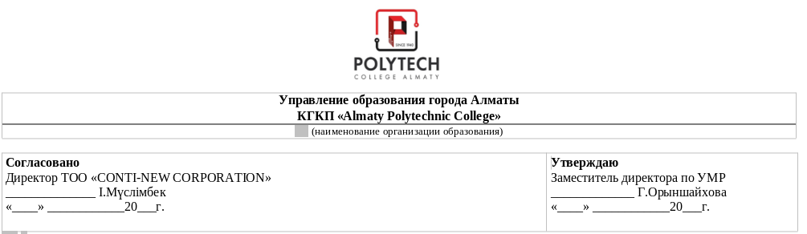
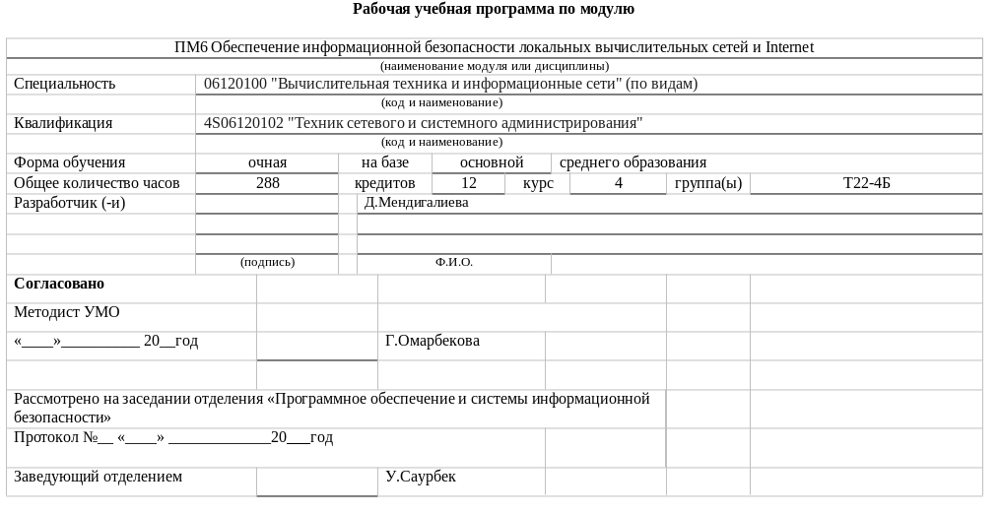
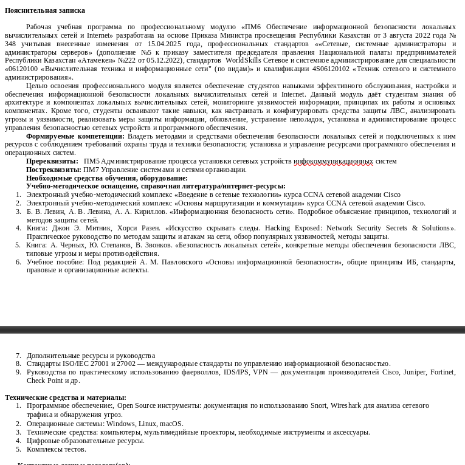
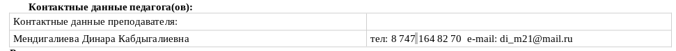
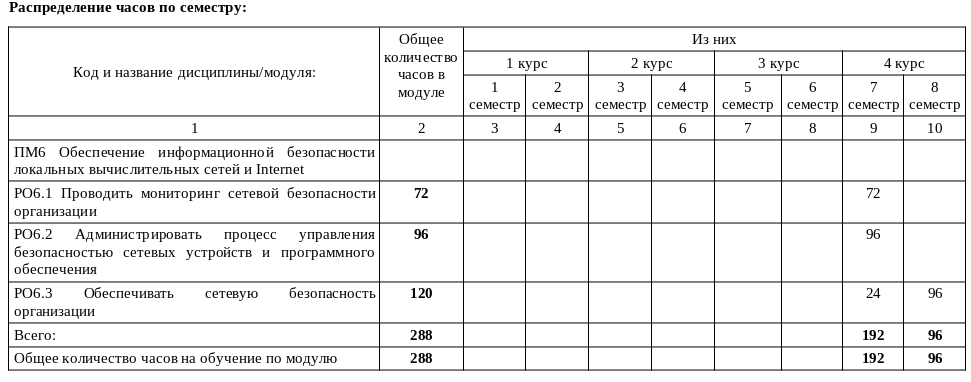
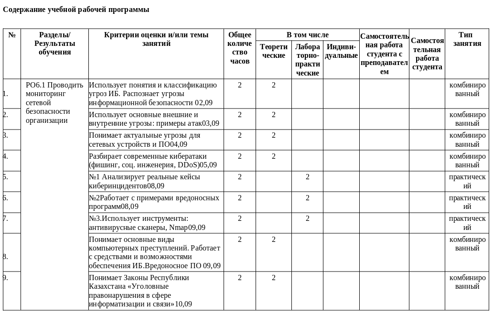

# Ознакомления с РУП

Здесь содержится краткое ознакомления с РУП, из чего документ состоит и как формируется.

РУП - рабочий учебный план то есть, существует учебный план - "ПМ6 Локальные сети", РУП описывает шаги по обучению по приказу 130 Министерство Образования Казахстана. Стандарты обучения берется с утвержденной национальной партий "Атамекен".

## Начало РУП

Начинается с наименований организации образования, с подписью согласованных лиц и утверждением других лиц.

### Называния, Специальность и Квалификация

-  Наименования модуля, например, "ПМ6 Обеспечение информационной безопасности локальных вычислительный сетей и Internet".
-  Специальность (код и наименования), например "06120100 'Вычислительная техника и информационные сети'"
-  Квалификация (код и наименования), "4S06120102 'Техник сетевого и системного администрирования'"
-  Форма обучения очная / заочная, на базе основной среднего образования
-  Общее количество часов (1 кредит = 24 часа)
-  -  Количество часов, 288 часов
-  -  Количество часов в кредитах 12
-  -  Курс обучения 4
-  -  Группа Т22-4Б
-  Разработчики (преподаватели), подпись и фио
-  Согласовано
-  -  Дата и подпись подтверждающих лиц
-  -  Информация о рассмотрения, например "Рассмотрено на заседании отделения 'Программное обеспечение и системы информационной безопасности'"
-  -  Номер протокола и дата
-  -  Подпись заведующего отделения

### Описания

У РУП существует полноценное описание, в нем рассказывается стандарт утверждения и цели

-  Формируемые компетенций это описание чего достигнет обучающий после окончания учебного плана.
-  Существует также пререквизиты и постреквизиты которые дают информаций что нужно пройти перед тем как начать обучения по этому РУП и какой РУП идет после.
-  Ресурсы, как правило ресурсы это блок где перечисляет статьи и учебники откуда был взят материал которые не должны быть старше 5 лет при составления РУП.
-  Технические средства и материалы это такой же блок как и ресурсы но перечисляется комплекс программ и с чем придется работать во время лабораторных тем.

### Контактные данные педагогов

Перечисляется контактные данные преподавателя, обычно это телефонный номер и электронная почта.

### Распределение часов по семестру

Эта таблица где показано все перечисленные разделы/дисциплины по семестрам и их количество часов, также общее количество часов (все считается в кредитах).
изначально идет называние РУП и дальше она делится на разделы/дисциплины. Справа находится таблица в который находится 4 курса и 8 семестра, каждый курс по 2 семестра. Дальше пишется сколько часов в каждом семестре в зависимости раздела. а также общее количество часов за семестр.
В конце высчитывается общее количество часов на обучение по модулю/РУП.

### Содержание учебной рабочей программы

Таблица где описывается дисциплины/разделы которые делятся на темы. У каждой темы имеется называния, часы и тип занятий.

-  Называния темы пишется глаголом "действий", то есть "Использует", "Понимает" и так далее.
-  Часы обычно это 2 часа если РУП является обучением по модулю или 6 часов если РУП является практическим.
-  У каждой темы можно выбрать один тип занятий из дальше перечисленных СРС (самостоятельная работа студента), комбинированный и практический. Дальше выставляется часы определенной темы.

После окончания добавления тем в определенной дисциплину/раздел высчитывается всего часов по каждому типу тем (часы должны делится на 24 (кредиты)), дальше показывается общие часы.

После окончания описания тем в каждой дисциплины/раздела суммируется общее количество часов у РУП.
